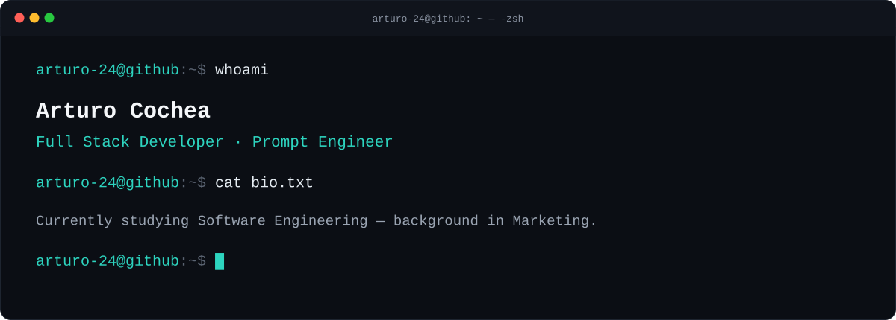
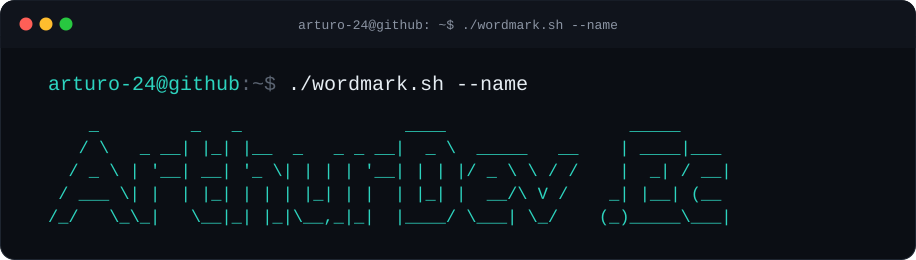
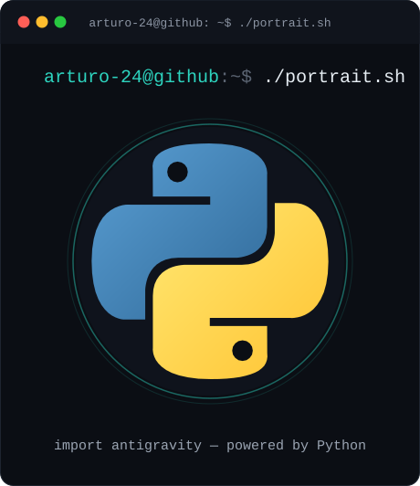

  

  

  

# 💫 About Me:
🔭 I’m currently working on Developing modern web applications and backend systems 👯 I’m looking to collaborate on Full-stack development and Python projects 🤝 I’m looking for help with Database optimization and cloud deployment 🌱 I’m currently learning Backend frameworks and ethical hacking 💬 Ask me about Python, Django, Web development, DataBases ⚡ Fun fact

## 🌐 Socials:
  

# 💻 Tech Stack:
          
# 📊 GitHub Stats:
 
 

---

  ## 💰 You can help me by Donating
   

  
<!-- Proudly created with GPRM ( https://gprm.itsvg.in ) --># 💫 About Me:
🔭 I’m currently working on Developing modern web applications and backend systems 👯 I’m looking to collaborate on Full-stack development and Python projects 🤝 I’m looking for help with Database optimization and cloud deployment 🌱 I’m currently learning Backend frameworks and ethical hacking 💬 Ask me about Python, Django, Web development, DataBases ⚡ Fun fact

## 🌐 Socials:
  

# 💻 Tech Stack:
          
# 📊 GitHub Stats:
 
 

---

  ## 💰 You can help me by Donating
   

  
<!-- Proudly created with GPRM ( https://gprm.itsvg.in ) -->
